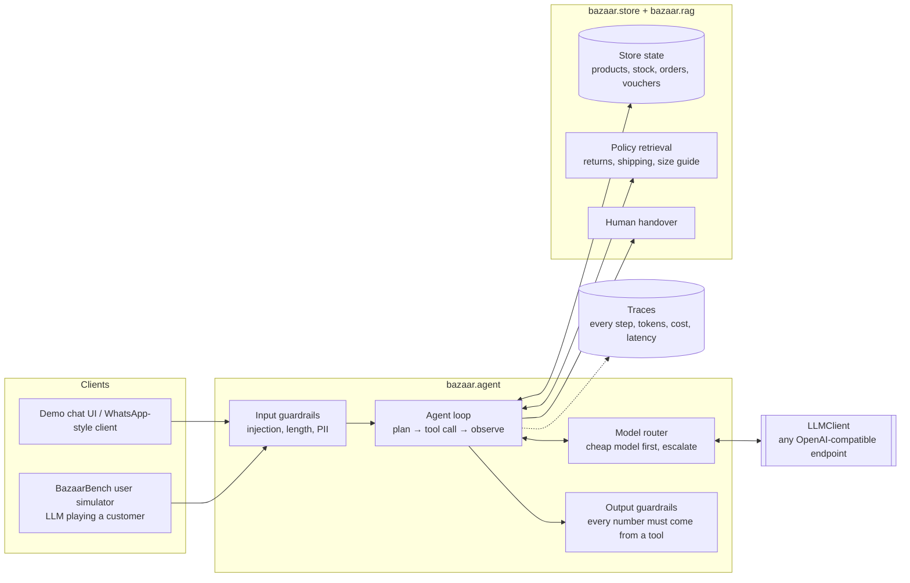
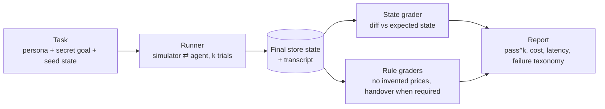

# Architecture

bazaar-agent has two halves that share one codebase:

- **The agent**: a customer-service agent for an Indonesian online fashion store, reachable over an HTTP API (and a demo chat UI).
- **BazaarBench**: a τ-bench-style benchmark that measures the agent (or any model) on realistic, multi-turn Indonesian commerce conversations.

The benchmark is the agent's test suite. Every claim the README makes about the agent is a BazaarBench number.

## System view

## Benchmark view

A task passes only if the store ends in exactly the expected state **and** every rule check passes. State comparison is deterministic and costs no LLM calls, which keeps grading cheap and reproducible (τ-bench uses the same idea).

## Package layout

| Package | Responsibility | Milestone |
|---|---|---|
| `bazaar.config` | Settings from env; secrets as `SecretStr` | M0 ✅ |
| `bazaar.llm` | Provider-agnostic `LLMClient`, OpenAI-compatible adapter, `FakeLLM` | M0 ✅ |
| `bazaar.store` | Fashion store domain model, seed data, tool functions | M1 |
| `bazaar.bench` | Task schema, user simulator, runner, graders, reports | M1 |
| `bazaar.agent` | Agent loop, system prompt (versioned), handover | M2 |
| `bazaar.rag` | Policy documents + BM25 retrieval | M2 |
| `bazaar.guardrails` | Input/output checks | M3 |
| `bazaar.routing` | Model routing by difficulty | M3 |
| `bazaar.api` | FastAPI service, rate limiting, demo UI | M5 |

## Decisions

Architecture decisions are recorded in [`docs/adr/`](adr/).
